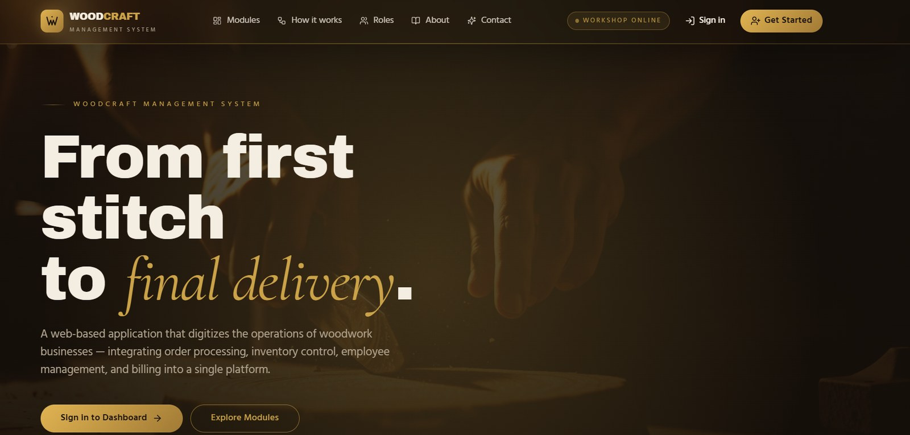
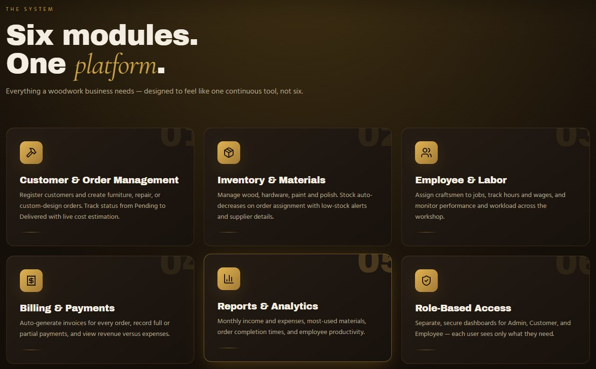
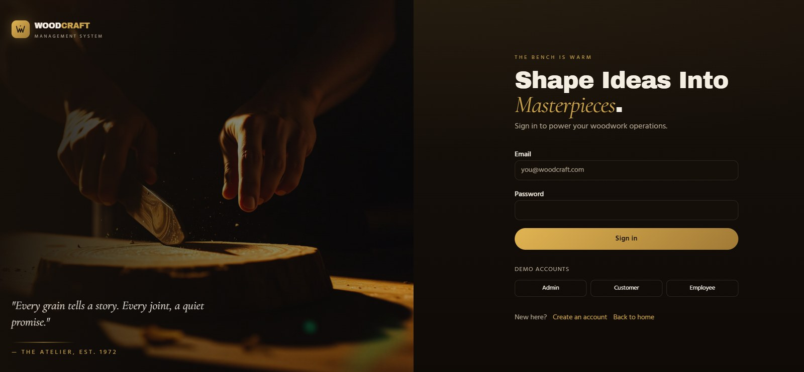
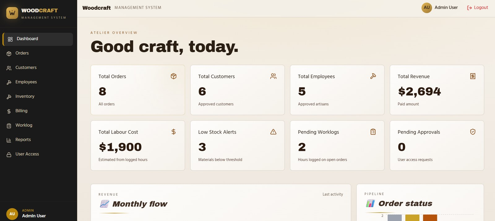
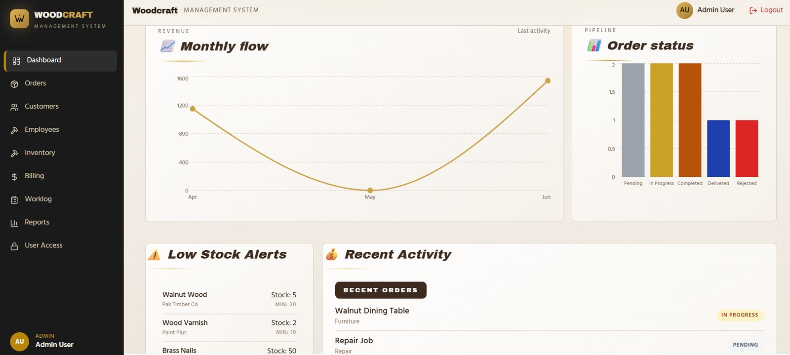
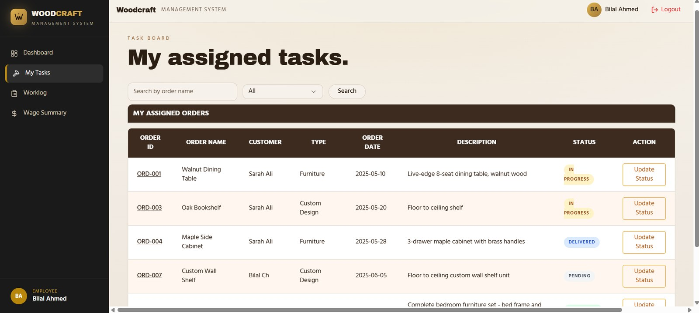
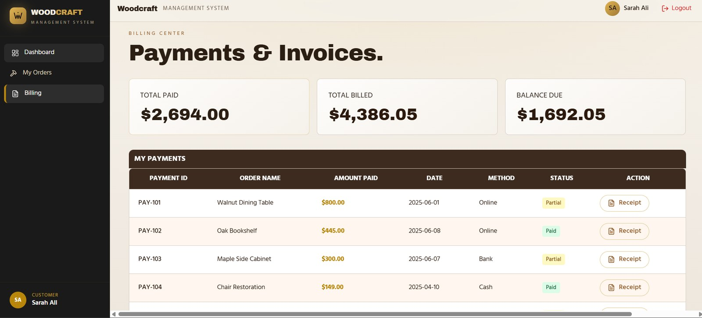
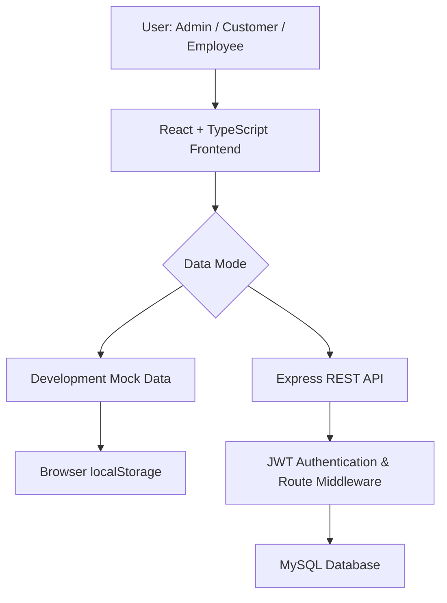
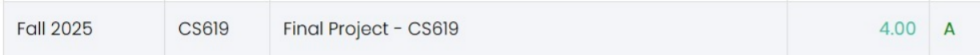
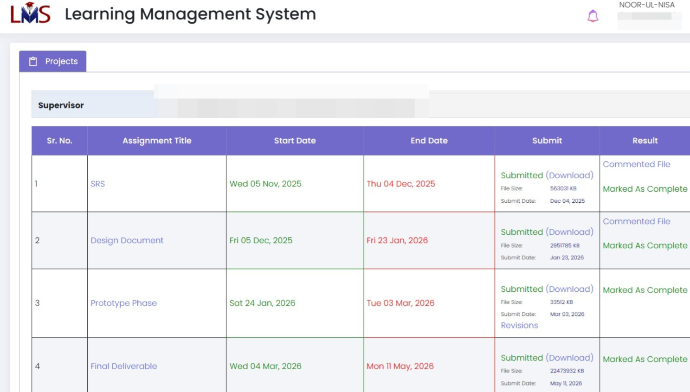

<div align="center">



<br><br>

# 🪵 Woodcraft Web Application

**A digital workspace for custom woodworking businesses**

Orders, workshop tasks, inventory, worklogs, billing and reports, all in one role-aware platform.

<br>


<br>

[Features](#-features) · [Screenshots](#-screenshots) · [Architecture](#-application-architecture) · [Structure](#-project-structure) · [Getting Started](#-getting-started) · [Routes](#-application-routes)

</div>

---

## 📌 Table of Contents

- [Overview](#-overview)
- [Why Woodcraft?](#-why-woodcraft)
- [Features](#-features)
- [User Roles](#-user-roles)
- [Screenshots](#-screenshots)
- [Technology Stack](#-technology-stack)
- [Application Architecture](#-application-architecture)
- [Project Structure](#-project-structure)
- [Getting Started](#-getting-started)
- [Application Routes](#-application-routes)
- [Security Notes](#-security-notes)
- [Academic Achievement](#-academic-achievement)
- [Future Improvements](#-future-improvements)

---

## 🌿 Overview

**Woodcraft** brings every step of a woodworking workshop into one place: from a customer's order to artisan work, material usage, invoicing and delivery. It offers separate experiences for **administrators**, **customers** and **employees**.

The frontend runs on its own in development mode using mock data and `localStorage`. An optional **Node.js + Express + MySQL** backend is included for API-based use.

---


## 🎯 Why Woodcraft?

Woodcraft demonstrates how web technologies can help digitize everyday business workflows.

- 🧩 **Centralized workflows** — bring orders, inventory, worklogs, billing, and reports into one application.
- 👥 **Role-aware experience** — show relevant pages and actions for each user role.
- 📦 **Resource visibility** — organize material stock and highlight low-stock levels.
- ⏱️ **Work tracking** — record assigned tasks and employee work hours.
- 🧾 **Financial organization** — connect invoices and payment records with customer orders.
- 📊 **Business insights** — present workshop and financial information through reports.

## ✨ Features

<details open>
<summary><strong>🔐 Authentication & Access Control</strong></summary>

- Login and registration interfaces.
- Role-based navigation for `admin`, `customer`, and `employee`.
- Registration approval workflow for customer and employee accounts.
- Backend reference implementation includes JWT authentication and password hashing.

</details>

<details open>
<summary><strong>📋 Customer & Order Management</strong></summary>

- Organize custom design, furniture creation, and repair/restoration orders.
- Track order progress through stages such as Pending, In Progress, Completed, and Delivered.
- Associate materials and employee tasks with orders.

</details>

<details>
<summary><strong>🪵 Inventory & Materials</strong></summary>

- Maintain records for lumber, finishes, hardware, and other workshop materials.
- Track stock levels, unit costs, and replenishment.
- Support low-stock awareness and material utilization reporting.

</details>

<details>
<summary><strong>👷 Employee, Worklog & Wage Tracking</strong></summary>

- Maintain employee profiles and skill information.
- Assign workshop tasks.
- Record hours worked and task notes.
- Summarize work hours and wage calculations.

</details>

<details>
<summary><strong>💳 Billing, Invoices & Payments</strong></summary>

- Link invoices with customer orders.
- Track invoice states such as Unpaid, Partial, and Paid.
- Record payments, calculate balances, and provide printable receipt actions.

</details>

<details>
<summary><strong>📊 Reports & Administration</strong></summary>

- Display workshop and financial analytics.
- Review revenue trends, material usage, and productivity information.
- Review registration requests and manage account status.
- Provide an administrative audit-log view.

</details>
---

## 👥 User Roles

| Role | What they can do |
| :--- | :--- |
| 👑 **Administrator** | Manage users and approvals, orders, inventory, employees, billing and reports |
| 🛒 **Customer** | Submit orders, follow progress, view invoices, make payments and view receipts |
| 🔨 **Employee** | View assigned tasks, update order status, submit worklogs and see wage summaries |

---

## 🖼️ Screenshots



<br>

<table>
  <tr>
    <td width="50%" align="center">
      <br>
      <sub><b>Login</b> with quick demo accounts</sub>
    </td>
    <td width="50%" align="center">
      <br>
      <sub><b>Admin</b> dashboard overview</sub>
    </td>
  </tr>
  <tr>
    <td align="center">
      <br>
      <sub><b>Admin</b> analytics and recent activity</sub>
    </td>
    <td align="center">
      <br>
      <sub><b>Employee</b> task board</sub>
    </td>
  </tr>
  <tr>
    <td colspan="2" align="center">
      <br>
      <sub><b>Customer</b> payments and invoices</sub>
    </td>
  </tr>
</table>

---

## 🛠️ Technology Stack

| Layer | Technologies |
| :--- | :--- |
| **Frontend** | React 18, TypeScript, Vite, Tailwind CSS, shadcn/ui + Radix UI, React Router, TanStack Query, Axios, Recharts, Lucide |
| **Backend** *(optional)* | Node.js, Express, MySQL (`mysql2`), JWT, bcrypt, dotenv, cors |
| **Testing** | Vitest |

---

## 🏗️ Application Architecture



**Development mode:** the frontend can use mock data and `localStorage` for interactive evaluation without a live database connection.

**API mode:** the frontend can send requests to the Express API, which connects to MySQL. Configure the backend environment variables before using this mode.

## 📁 Project Structure

```text
Woodcraft/
├── backend/                      # Node.js + Express API
│   ├── middleware/               # Authentication and authorization
│   ├── routes/                   # Auth, orders, inventory, billing, etc.
│   ├── .env                      # Local environment variables (never commit)
│   ├── db.js                     # Database connection
│   ├── package.json
│   ├── package-lock.json
│   └── server.js                 # API entry point
├── database/
│   ├── woodcraft.sql
│   └── woodcraft_full_schema.sql
├── docs/                         # README media
│   ├── screenshots/              # Application screenshots
│   └── diagrams/                 # Architecture and class diagrams
├── dist/                         # Production build output (generated)
├── public/                       # Static assets
├── reference/
│   └── README.md                 # Backend implementation guide
├── src/
│   ├── assets/                   # Images and brand assets
│   ├── components/               # Shared layout and UI components
│   ├── hooks/                    # Custom React hooks
│   ├── lib/                      # API, auth, calculations, mock data
│   ├── pages/                    # Dashboards and application pages
│   ├── services/                 # API integration services
│   ├── test/                     # Vitest tests and setup
│   ├── App.css
│   ├── App.tsx                   # Routes and providers
│   ├── index.css                 # Global styles
│   ├── main.tsx                  # Entry point
│   └── vite-env.d.ts
├── .gitignore
├── bun.lockb
├── components.json               # shadcn/ui configuration
├── eslint.config.js
├── index.html
├── package.json
├── package-lock.json
├── postcss.config.js
├── README.md
├── tailwind.config.ts
├── tsconfig.json
├── tsconfig.app.json
├── tsconfig.node.json
├── vite.config.ts
└── vitest.config.ts
```

*This is a high-level guide; exact files may differ as the project evolves.*

---

## 🚀 Getting Started

**Requirements:** Node.js v18+ and npm. MySQL is only needed for the optional backend.

```bash
git clone https://github.com/YOUR-USERNAME/Woodcraft-Web-Application.git
cd Woodcraft-Web-Application
npm install
npm run dev
```

Open **http://localhost:5173**. The frontend works in mock-data mode without any database.

<details>
<summary><b>Optional: backend and database</b></summary>

<br>

```bash
cd backend
npm install
npm run dev
```

Create `backend/.env` (never commit it):

```env
DB_HOST=localhost
DB_USER=your_local_mysql_user
DB_PASS=your_local_mysql_password
DB_NAME=woodcraft
JWT_SECRET=replace_with_a_long_random_secret
PORT=5000
```

Import the schema:

```bash
mysql -u your_local_mysql_user -p < database/woodcraft.sql
```

</details>

| Script | Purpose |
| :--- | :--- |
| `npm run dev` | Start the development server |
| `npm run build` | Build for production |
| `npm run preview` | Preview the production build |
| `npm run lint` | Run lint checks |
| `npm run test` | Run tests |

---

## 🧭 Application Routes

| Route | Description | Access |
| :--- | :--- | :--- |
| `/` | Public homepage | Public |
| `/login` · `/register` | Sign in and registration request | Public |
| `/app` | Role-aware dashboard | All roles |
| `/app/orders` | Orders and task tracking | Role-dependent |
| `/app/inventory` | Material stock and pricing | Admin |
| `/app/employees` · `/app/customers` | Directories | Admin |
| `/app/billing` | Invoices and payments | Admin, Customer |
| `/app/worklog` | Work-hour tracking | Admin, Employee |
| `/app/wage-summary` | Wage summary | Employee |
| `/app/reports` | Business reports | Admin |
| `/app/user-access` | Registration approvals | Admin |

---

## 🔐 Security Notes

- Never commit `.env` files, secrets or database credentials.
- Replace demo accounts and hardcoded credentials before any public deployment.
- Mock mode is for demonstration, not a production security boundary.

---

## 🎓 Academic Achievement

**Final Year Project — Woodcraft Web Application**

- **Grade:** A+
- **GPA:** 4.00 / 4.00

<table>
  <tr>
    <td align="center">
      <br>
      <sub><b>Final result</b>: Fall 2025, CS619, 4.00 (A)</sub>
    </td>
  </tr>
  <tr>
    <td align="center">
      <br>
      <sub><b>Project milestones</b>: SRS, Design Document, Prototype Phase and Final Deliverable, all marked complete</sub>
    </td>
  </tr>
</table>

This project provided practical experience in web application development, component-based UI design, role-aware navigation, database concepts, API integration, and organizing real-world business workflows.

## 🌱 Future Improvements

Potential directions for further development include:

- Add automated tests for key workflows and access-control rules.
- Improve accessibility and responsive behavior across devices.
- Add deployment documentation and a safe demo environment.
- Expand audit logging and validation around important business actions.
- Add sanitized screenshots and a short project walkthrough video.

## 🤝 Feedback

Suggestions and constructive feedback are welcome. If you explore the project, feel free to share ideas for improving its usability, code quality, or security.

---

<div align="center">

**🪵 Woodcraft Web Application**

*Designed to bring workshop workflows into one organized digital experience.*

⭐ If you find this project useful or interesting, consider starring the repository.

</div>
