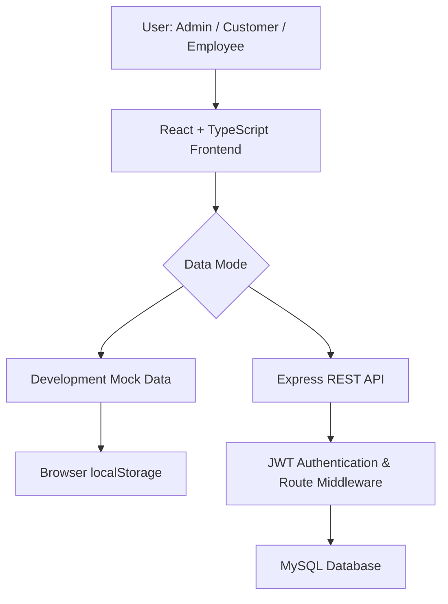

<div align="center">


<br><br>

# 🪵 Woodcraft Web Application

**A digital workspace for custom woodworking businesses**

Orders, workshop tasks, inventory, worklogs, billing and reports, all in one role-aware platform.

<br>


<br>

[Features](#-features) · [Screenshots](#-screenshots) · [Architecture](#-application-architecture) · [Structure](#-project-structure) · [Getting Started](#-getting-started) · [Routes](#-application-routes)

</div>

---

## 🌿 Overview

**Woodcraft** brings every step of a woodworking workshop into one place: from a customer's order to artisan work, material usage, invoicing and delivery. It offers separate experiences for **administrators**, **customers** and **employees**.

The frontend runs on its own in development mode using mock data and `localStorage`. An optional **Node.js + Express + MySQL** backend is included for API-based use.

---

## ✨ Features

<table>
  <tr>
    <td width="33%" valign="top">
      <h3>🔐 Access Control</h3>
      Role-based dashboards and an approval workflow for new customer and employee accounts.
    </td>
    <td width="33%" valign="top">
      <h3>📋 Orders</h3>
      Custom design, furniture and repair orders tracked from Pending to Delivered.
    </td>
    <td width="33%" valign="top">
      <h3>🪵 Inventory</h3>
      Material stock, unit costs and low-stock alerts, with stock reduced as orders are assigned.
    </td>
  </tr>
  <tr>
    <td valign="top">
      <h3>👷 Employees & Wages</h3>
      Task assignment, logged work hours and automatic wage summaries.
    </td>
    <td valign="top">
      <h3>💳 Billing</h3>
      Invoices linked to orders, full or partial payments, balances and receipts.
    </td>
    <td valign="top">
      <h3>📊 Reports</h3>
      Revenue trends, order status, material usage and productivity charts.
    </td>
  </tr>
</table>

---

## 👥 User Roles

| Role | What they can do |
| :--- | :--- |
| 👑 **Administrator** | Manage users and approvals, orders, inventory, employees, billing and reports |
| 🛒 **Customer** | Submit orders, follow progress, view invoices, make payments and view receipts |
| 🔨 **Employee** | View assigned tasks, update order status, submit worklogs and see wage summaries |

---

## 🖼️ Screenshots


<br>

<table>
  <tr>
    <td width="50%" align="center">
      <br>
      <sub><b>Login</b> with quick demo accounts</sub>
    </td>
    <td width="50%" align="center">
      <br>
      <sub><b>Admin</b> dashboard overview</sub>
    </td>
  </tr>
  <tr>
    <td align="center">
      <br>
      <sub><b>Admin</b> analytics and recent activity</sub>
    </td>
    <td align="center">
      <br>
      <sub><b>Employee</b> task board</sub>
    </td>
  </tr>
  <tr>
    <td colspan="2" align="center">
      <br>
      <sub><b>Customer</b> payments and invoices</sub>
    </td>
  </tr>
</table>

---

## 🛠️ Technology Stack

| Layer | Technologies |
| :--- | :--- |
| **Frontend** | React 18, TypeScript, Vite, Tailwind CSS, shadcn/ui + Radix UI, React Router, TanStack Query, Axios, Recharts, Lucide |
| **Backend** *(optional)* | Node.js, Express, MySQL (`mysql2`), JWT, bcrypt, dotenv, cors |
| **Testing** | Vitest |

---

## 🏗️ Application Architecture



**Development mode:** mock data and `localStorage`, no database needed.
**API mode:** requests go to the Express API, which connects to MySQL.

---

## 📁 Project Structure

```text
Woodcraft/
├── backend/            # Express API (middleware, routes, db.js, server.js)
├── database/           # woodcraft.sql, woodcraft_full_schema.sql
├── docs/screenshots/   # README images
├── dist/               # Production build output
├── public/             # Static assets
├── reference/          # Backend implementation guide
├── src/
│   ├── assets/
│   ├── components/     # Layout and UI components
│   ├── hooks/
│   ├── lib/            # API, auth, calculations, mock data
│   ├── pages/          # Dashboards and application pages
│   ├── services/
│   ├── test/
│   ├── App.tsx
│   └── main.tsx
├── package.json
├── tailwind.config.ts
├── tsconfig.json
├── vite.config.ts
└── vitest.config.ts
```

---

## 🚀 Getting Started

**Requirements:** Node.js v18+ and npm. MySQL is only needed for the optional backend.

```bash
git clone https://github.com/YOUR-USERNAME/Woodcraft-Web-Application.git
cd Woodcraft-Web-Application
npm install
npm run dev
```

Open **http://localhost:5173**. The frontend works in mock-data mode without any database.

<details>
<summary><b>Optional: backend and database</b></summary>

<br>

```bash
cd backend
npm install
npm run dev
```

Create `backend/.env` (never commit it):

```env
DB_HOST=localhost
DB_USER=your_local_mysql_user
DB_PASS=your_local_mysql_password
DB_NAME=woodcraft
JWT_SECRET=replace_with_a_long_random_secret
PORT=5000
```

Import the schema:

```bash
mysql -u your_local_mysql_user -p < database/woodcraft.sql
```

</details>

| Script | Purpose |
| :--- | :--- |
| `npm run dev` | Start the development server |
| `npm run build` | Build for production |
| `npm run preview` | Preview the production build |
| `npm run lint` | Run lint checks |
| `npm run test` | Run tests |

---

## 🧭 Application Routes

| Route | Description | Access |
| :--- | :--- | :--- |
| `/` | Public homepage | Public |
| `/login` · `/register` | Sign in and registration request | Public |
| `/app` | Role-aware dashboard | All roles |
| `/app/orders` | Orders and task tracking | Role-dependent |
| `/app/inventory` | Material stock and pricing | Admin |
| `/app/employees` · `/app/customers` | Directories | Admin |
| `/app/billing` | Invoices and payments | Admin, Customer |
| `/app/worklog` | Work-hour tracking | Admin, Employee |
| `/app/wage-summary` | Wage summary | Employee |
| `/app/reports` | Business reports | Admin |
| `/app/user-access` | Registration approvals | Admin |

---

## 🔐 Security Notes

- Never commit `.env` files, secrets or database credentials.
- Replace demo accounts and hardcoded credentials before any public deployment.
- Mock mode is for demonstration, not a production security boundary.

---

## 🎓 Academic Achievement

**Final Year Project: Woodcraft Web Application** · Grade **A+** · GPA **4.00 / 4.00**

---

<div align="center">

**🪵 Woodcraft Web Application**

*Designed to bring workshop workflows into one organized digital experience.*

⭐ If you find this project useful, consider starring the repository.

</div>
